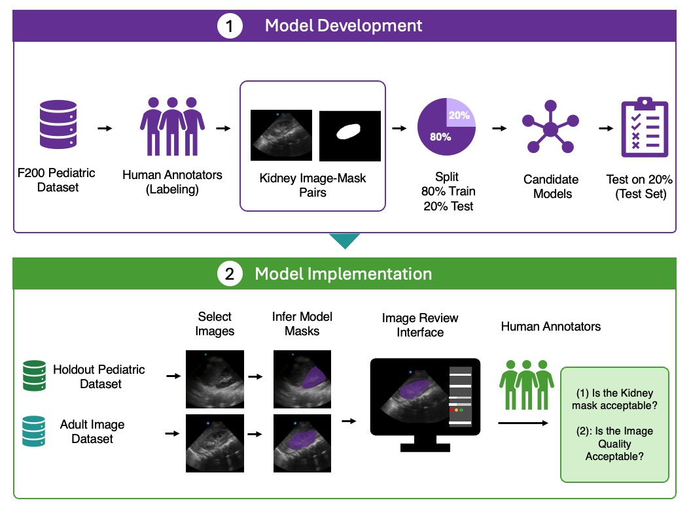
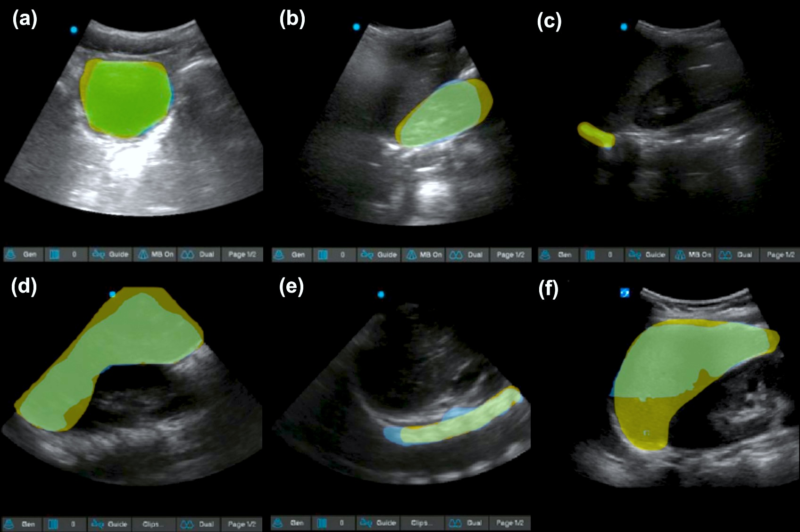

# US-AbdomenSeg

Research Repository for multi-organ segmentation in abdominal ultrasound using deep learning models 

> *Objective*: To describe the development and implementation of machine learning models to automatically localize and segment six abdominal organs in pediatric FAST.
> 
>Methods: We developed or fine-tuned models based on the U-Net, EVIT U-Net, UltraSAM and nnUnet architectures to automate the segmentation of six key organs in FAST: kidney, bladder, liver, diaphragm, spleen, and spine. Accuracy of the automated segmentation was assessed by measuring the Dice-Sørensen similarity (DSC) against manual annotations. Pediatric ultrasound experts also evaluated the acceptability of organ segments placed on RUQ, LUQ and Pelvic views in previously unlabeled pediatric and adult images in our image review platform.



Repository includes separate Organ Model Weights for U-Net and Evit-U-Net



## Organ Segment Dice Similarity on Pediatric FAST test set


| Organ | Bladder | Kidney | Liver | Spleen | Spine | Diaphragm |
| --- | --- | --- | --- | --- | --- | --- |
| Manually Labeled Images | n=344 | n=306 | n=445 | n=172 | n=273 | n=267 |
| UNet | 0.90 | 0.92 | 0.84 | 0.70 | 0.69 | 0.62 |
| EVIT-UNet | 0.92 | 0.93 | 0.90 | 0.82 | 0.66 | 0.61 |
| UltraSam | 0.91 | 0.91 | 0.90 | 0.81 | 0.70 | 0.66 |
| nnUNet | 0.92 | 0.85 | 0.89 | 0.60 | 0.69 | 0.67 |


## Model implementation features

| Model | Source | Implementation | Input image Size (px) | Approximate Model Size on Disk | Mean Inference Time* |
| --- | --- | --- | ---: | ---: | ---: |
| UNet | [tensorflow/tensorflow](https://github.com/tensorflow/tensorflow) | Tensorflow (Trained up to 40 Epochs) | 256 × 256 | 25 MB | 35 ms |
| EVIT-UNet | [Retinal-Research/EVIT-UNET](https://github.com/Retinal-Research/EVIT-UNET) | Pytorch (Trained up to 300 Epochs) | 224 × 224 | 250 MB | 54 ms |
| UltraSam | [CAMMA-public/UltraSam](https://github.com/CAMMA-public/UltraSam) | Pytorch (Trained up to 2000 Epochs) | 1024 × 768 (padded) | 360 MB | 124 ms |
| nnUNet | [MIC-DKFZ/nnUNet](https://github.com/MIC-DKFZ/nnUNet) | Pytorch (Trained up to 250 Epochs) | 960 × 720 | 350 MB | 172 ms |


## Repository Structure

```
US-AbdomenSeg/
├── assets/                      # Figures and images used in the README
├── weights_files/               # Downloadable model weights, organized by model
│   ├── evit-unet/
│   │   ├── architecture.md      # Model architecture details
│   │   ├── bladder.pth
│   │   ├── kidney.pth
│   │   └── ...                  # One weights file per anatomical structure
│   └── unet/
│       ├── architecture.md
│       ├── bladder.h5
│       └── ...                  # One weights file per anatomical structure
└── README.md
```


## How to Use

1. Clone the repository
```bash
git clone git@github.com:Kornblith-Lab/US-AbdomenSeg.git
```
2. Install requirements
```bash
cd US-AbdomenSeg
pip install -r requirements.txt
```

3. Download Weights
The model weights can be downloaded from the weights_files folder. Weights are organized by model type (e.g., UNet, EViT-UNet) and separated by anatomical structure.


4. Run Inference

5. Train

6. Test

