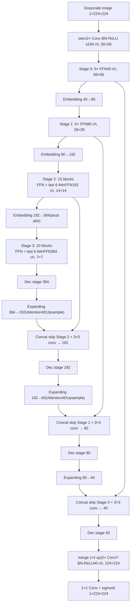

# EViT-UNet Architecture

U-shaped hybrid CNN + Transformer network for binary organ segmentation. The network takes a **grayscale image of size 1 × 224 × 224** and predicts a single-channel mask. The encoder is an 
**EfficientFormerV2-L** backbone. Each organ is trained as a 
separate binary model.

## Overview

This is a **hybrid EfficientFormerV2 U-Net**. Each 
organ is a **separate binary model**: one **grayscale image** in, one probability map out. The encoder is a 4-stage EfficientFormerV2 backbone; each stage stacks depthwise-conv MLP blocks (`FFN`) and, in the deeper 
stages, attention blocks (`AttnFFN` using 
`Attention4D`). Downsampling between stages uses patch `Embedding` (a strided conv, plus an 
`Attention4DDownsample` branch in the deep stages). The decoder mirrors this with `Expanding` (transposed-conv upsampling, `Attention4DUpsample` in shallow stages), concatenation skips, and a sigmoid head.

| Item | Value |
| --- | --- |
| Framework | PyTorch, `timm` layers (`DropPath`, `trunc_normal_`) |
| Backbone | EfficientFormerV2-L (`Eff_Unet`) |
| Input | **Grayscale image**, shape **`(B, 1, 224, 224)`**, `float32` (stem first conv is `Conv2d(120, 3×3)`) |
| Output | shape `(B, 1, 224, 224)`, **sigmoid** (because `num_classes == 1`) |
| Encoder stage dims | `embed_dims = [40, 80, 192, 384]` |
| Encoder stage depths | `layers = [5, 5, 15, 10]` |
| Attention blocks | `vit_num = 6` (last blocks of the deeper stage sare attention) |
| Expansion (MLP) ratios | per-block from `expansion_ratios_L` (mix of 3 and 4) |
| Convolution | `3×3` with `same`-style padding; `1×1` projections in MLP/attention |
| Normalization | BatchNorm2d throughout encoder/decoder |
| Activation | GELU in MLPs; ReLU in attention/proj and stem/merge |
| Downsample | `stem` (÷4) then patch `Embedding` `3×3` stride-2 convs |
| Upsample | `merge` (×4) and `Expanding` transposed-conv `3×3` stride-2 |
| Skip connections | concat + `3×3` conv to halve channels (`CCA` gate built but bypassed for binary) |
| Head | `Conv2d(40, 1, 1×1, bias=False)` + `Sigmoid` |
| Layer scale | `layer_scale_init_value = 1e-5` (`layer_scale_1/2` params) |
| Regularization | `drop_path_rate = 0.1` (stochastic depth) |
| Optimizer (pretrain ckpt) | AdamW, `lr=1e-5`→base `3e-3`, `β1=0.9`, `β2=0.999`, `eps=1e-8`, cosine schedule |

## Block diagram

## Stage map (encoder)

`resolution = 224`; stage `i` runs at `ceil(224 / 
2^(i+2))`. The stem downsamples by 4 (two stride-2 
convs), so stage 0 runs at `56×56`. BatchNorm taps at 
`out_indices = [0, 2, 4, 6]` provide the skip tensors.

| Stage | Module | Blocks | Channels | Spatial | Skip |
| --- | --- | ---: | ---: | ---: | --- |
| Stem | `stem(1, 40)` | 2 conv | 1→40 | 56 | — |
| Stage 0 (`network.0`) | `eformer_block` | 5 × FFN | 40 | 56 | → decoder |
| Embed 0→1 (`network.1`) | `Embedding` | — | 40→80 | 28 | |
| Stage 1 (`network.2`) | `eformer_block` | 5 × FFN | 80 | 28 | → decoder |
| Embed 1→2 (`network.3`) | `Embedding` | — | 80→192 | 14 | |
| Stage 2 (`network.4`) | `eformer_block` | 15 (9 FFN + last 6 `AttnFFN`) | 192 | 14 | → decoder |
| Embed 2→3 (`network.5`) | `Embedding` (asub) | — | 192→384 | 7 | conv branch + `Attention4DDownsample` |
| Stage 3 (`network.6`) | `eformer_block` | 10 (4 FFN + last 6 `AttnFFN`) | 384 | 7 | bottleneck |

Attention placement follows `eformer_block`: within a 
stage, when `index >= 2` and the block is among the 
last `vit_num = 6` blocks, an `AttnFFN` (with 
`Attention4D`) is used instead of an `FFN`. Stage 2 
additionally uses `stride = 2` inside its attention 
(down-then-upsample within the token mixer); stage 3 
has no `stride_conv`.

## Decoder

The decoder (`network_up_layers`) mirrors the encoder 
over reversed dims `[384, 192, 80, 40]` with reversed 
depths and `expansion_ratios_L_reverse`. `skip_conn = 
[0, 2, 4, 6]` selects the skip-fusion entries; the 
remaining entries are `Expanding` upsamplers.

| Decoder step | Module | Channels | Spatial | Skip |
| --- | --- | ---: | ---: | --- |
| Dec stage (bottleneck) | `eformer_block_up` | 384 | 7 | — |
| Expanding | `Expanding` (asub, `Attention4DUpsample`) | 384→192 | 14 | |
| Skip + Dec stage | concat / `3×3` conv / `eformer_block_up` | 192 | 14 | encoder stage 2 |
| Expanding | `Expanding` (asub, `Attention4DUpsample`) | 192→80 | 28 | |
| Skip + Dec stage | concat / `3×3` conv / `eformer_block_up` | 80 | 28 | encoder stage 1 |
| Expanding | `Expanding` | 80→40 | 56 | |
| Skip + Dec stage | concat / `3×3` conv / `eformer_block_up` | 40 | 56 | encoder stage 0 |
| merge | `merge` (2× ConvT stride-2) | 40 | 224 | ×4 upsample |
| Head | `Conv2d(40, 1, 1×1)`, sigmoid | 1 | 224 | — |

Skip fusion (`forward_up_features`) differs by task:
- **Binary (`num_classes == 1`, this model):** plain 
concat of the decoder feature with the matching encoder 
tap, then `concat_back_dim` `3×3` conv. The `CCA` 
modules are built but bypassed.
- **Multi-class:** `CCA` channel attention is applied 
to the skip before concat.

## Building blocks

- **`Mlp` (mid-conv MLP):** `Conv1×1 → BN → GELU → 
[depthwise Conv3×3 → BN → GELU] → Conv1×1 → BN`. 
Corresponds to the `mlp.fc1 / mid / fc2` tensors in the 
weight dump. `hidden = dim × mlp_ratio` (3 or 4).
- **`FFN`:** residual `x + layer_scale_2 · mlp(x)`. 
Only `layer_scale_2` exists (no token mixer).
- **`AttnFFN`:** residual `x + layer_scale_1 · 
token_mixer(x)`, then `x + layer_scale_2 · mlp(x)`. Has 
both `layer_scale_1` and `layer_scale_2`.
- **`Attention4D`:** multi-head attention (`num_heads = 
8`, `key_dim = 32`). `q/k` project to 
`key_dim·num_heads = 256`, `v` to 
`attn_ratio·key_dim·num_heads = 1024`, plus a depthwise 
`v_local`, two `talking_head` 1×1 convs, relative 
`attention_biases`, and a ReLU + `proj`. Optional 
`stride_conv` + bilinear `upsample` for 
downsample-inside-attention.
- **`Attention4DDownsample` / `LGQuery`:** `num_heads = 
8`, `key_dim = 16` (`q/k` → 128, `v` → 512). Query is 
`AvgPool + depthwise stride-2 conv` (halves 
resolution); used inside deep `Embedding` layers 
(`asub=True`). Has relative `attention_biases`.
- **`Attention4DUpsample` / `UpLGQuery`:** query uses 
bilinear upsample + transposed conv (doubles 
resolution); used inside shallow `Expanding` layers 
(`asub=True`). No `attention_biases`.
- **`Embedding`:** patch merge. `asub` = strided-conv 
branch + `Attention4DDownsample` branch summed; else 
plain strided conv + BN.
- **`Expanding`:** patch expand (transposed conv), 
mirror of `Embedding`, with `Attention4DUpsample` 
branch when `asub`.
- **`CCA`:** channel-wise cross attention — 
global-avg-pool both `g` and `x`, MLP each, average, 
sigmoid gate, scale `x`, ReLU. Used for multi-class 
skips only.

## Loss
Training uses a combined **BCE + Dice** objective 
(binary, `num_classes = 1`):

- Training loss is a weighted sum: `0.4 · BCE + 0.6 · Dice`.
- `BCE`: binary cross-entropy (`nn.BCELoss`) between the sigmoid output and the mask.
- `Dice`: soft Dice loss (`utils.DiceLoss`) over the flattened prediction and mask.

## Differences from the original U-Net

Relative to Ronneberger et al. (2015):

- **Hybrid backbone**: EfficientFormerV2 
transformer/CNN stages instead of pure double-conv CNN; 
deep stages use **`Attention4D` self-attention** for 
global context.
- **Grayscale** `(1, 224, 224)` input, not color `(256, 
256, 3)`.
- Stage widths **40 → 80 → 192 → 384**, depths **[5, 5, 15, 10]**, instead of 16→32→64→128→256 with depth-2 
blocks.
- The stem does **×4 downsampling in one shot**; 
`Embedding` / `Expanding` (some with attention 
branches) replace `MaxPool` / plain `ConvTranspose`.
- Skips use a learned **concat-reduction `3×3` conv** 
(with an optional CCA gate for multi-class), not a bare 
concatenate.
- **BatchNorm + GELU/ReLU** with **LayerScale** and 
**DropPath** on residual branches.
- Encoder (and mirrored decoder) is **warm-started from 
ImageNet pretraining**.
- Final activation is **sigmoid** for one-vs-rest organ 
masks, not softmax over multiple classes.

## Inference notes

- On load, encoder keys `network.<i>.*` map to 
`network_down_layers.<i>.*` and are also mirrored to 
`network_up_layers.<6 - i>.*` to warm-start the 
decoder; shape-mismatched tensors (the `3→1` stem conv, 
the `head`/`dist_head` classifiers, the final `norm`) 
are dropped (`strict=False`).
- Feed a `float32` tensor shaped **`(B, 1, 224, 224)`** 
(single channel). The 3-channel ImageNet stem is not 
reused.
- Output is sigmoid-activated in eval mode 
(`num_classes == 1`); threshold (commonly `0.5`) to 
obtain a binary mask.
- Run **one checkpoint per organ**; not a single 
multi-class network.
- Constructor args: `layers=[5,5,15,10]`, 
`embed_dims=[40,80,192,384]`, 
`downsamples=[True,True,True,True]`, `vit_num=6`, 
`drop_path_rate=0.1`, `num_classes=1`.,