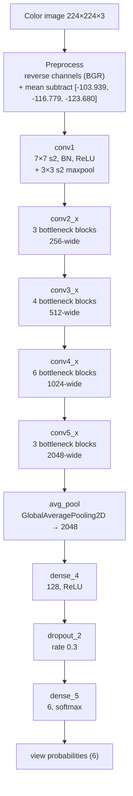

# View-Classifier (ResNet50) Architecture

`ResNet50`-backbone image classifier for 6-way 
ultrasound view classification. The network takes a 
**color image of size 224 × 224 × 3** and predicts a 
6-class softmax vector. The graph below is taken 
from the Keras `model_config` stored in 
`ViewClass_082526.h5` (Keras **2.13.1**, TensorFlow backend). The 
backbone is standard ImageNet ResNet50 with a small 
custom classification head.

> Note: The class label ↔ index mapping (which of the 6 
outputs corresponds to which view/organ) is **not 
stored in the weights file** and is left blank.

## Overview

This is a transfer-learning **ResNet50 classifier**. This classifer takes in one 
color image and outputs a 6-way probability vector.
Preprocessing (BGR flip + mean subtraction) is baked 
into the graph as `keras.applications.resnet50`-style 
`caffe` preprocessing. The ResNet50 backbone is largely 
frozen; only the later blocks are trainable (see 
below). The head consists of a single hidden layer followed by a softmax classifier.

| Item | Value |
| --- | --- |
| Framework | Keras Functional API (`name="model_2"`) 
|
| Input | `input_6`, shape **`(224, 224, 3)`**, 
`float32` (height × width × RGB channels) |
| Preprocessing | `tf.__operators__.getitem` (reverse 
channels → BGR) then `tf.nn.bias_add` with `[-103.939, 
-116.779, -123.680]` (caffe-style mean subtraction) |
| Backbone | `resnet50` (Functional submodel), output 
`avg_pool` = `GlobalAveragePooling2D`, `(2048,)` |
| Head | `dense_4` (128, ReLU) → `dropout_2` (rate 0.3) 
→ `dense_5` (6, softmax) |
| Output | `dense_5`, shape `(6,)`, softmax |
| Convolution | ResNet50 standard (`7×7` stem, 
`1×1`/`3×3`/`1×1` bottlenecks), bias on, 
**GlorotUniform** |
| Normalization | BatchNorm, `axis=channels`, momentum 
`0.99`, ε `1.001e-05` |
| Downsample | `7×7` stride-2 stem conv + `3×3` 
stride-2 maxpool, then stride-2 `1×1` at each stage 
transition |
| Pooling head | `GlobalAveragePooling2D` (`avg_pool`) 
|
| Parameters | ResNet50 backbone (~23.6 M) + head 
`2048×128 + 128` and `128×6 + 6` (~262 K) |
| Trainable scope | `conv4_block6` onward + `conv5_*` + 
dense head trainable; earlier layers `trainable=false` 
|
| Loss | (not stored — left blank) |
| Metrics | (not stored — left blank) |
| Optimizer (compiled) | Adam (from 
`optimizer_weights`; hyperparameters not fully stored — 
left blank) |

## Block diagram

## Stage map

Standard ResNet50 backbone (v1, `conv`-style residual 
with BN on the shortcut projection). Spatial size 
assumes `224×224` input.

| Stage | Operation | Spatial | Channels | Trainable |
| --- | --- | ---: | ---: | --- |
| Input | Color image (RGB) | 224 | 3 | — |
| Preprocess | BGR flip + mean subtract | 224 | 3 | — 
|
| conv1 | `7×7` conv s2, BN, ReLU, `3×3` maxpool s2 | 
56 | 64 | false |
| conv2_x | 3 × bottleneck (`1×1`→`3×3`→`1×1`) | 56 | 
256 | false |
| conv3_x | 4 × bottleneck (first block s2) | 28 | 512 
| false |
| conv4_x | 6 × bottleneck (first block s2) | 14 | 1024 
| partial (block6 trainable) |
| conv5_x | 3 × bottleneck (first block s2) | 7 | 2048 
| true |
| avg_pool | GlobalAveragePooling2D | 1 | 2048 | true 
|
| dense_4 | Dense, ReLU | — | 128 | true |
| dropout_2 | Dropout (rate 0.3) | — | 128 | true |
| dense_5 | Dense, softmax | — | 6 | true |

### ResNet50 bottleneck block

Each block (`convN_blockM`):

1. `1×1` Conv → BN → ReLU (`_1_conv`, `_1_bn`, 
`_1_relu`)
2. `3×3` Conv (`same`) → BN → ReLU (`_2_conv`, `_2_bn`, 
`_2_relu`)
3. `1×1` Conv → BN (`_3_conv`, `_3_bn`)
4. Shortcut: identity, or `1×1` Conv → BN projection 
(`_0_conv`, `_0_bn`) on the first block of a stage
5. `Add` shortcut + main branch → ReLU (`_add`, 
`_out`)

The first block of `conv3_x`, `conv4_x`, and `conv5_x` 
uses a stride-2 `1×1` on both the main `_1_conv` and 
the `_0_conv` projection to downsample.

## Preprocessing detail

The graph implements Keras `resnet50.preprocess_input` 
(`caffe` mode) inline:

- `tf.__operators__.getitem` with slice `[..., ::-1]` → 
reverses the last (channel) axis (RGB → BGR).
- `tf.nn.bias_add` with bias `[-103.939, -116.779, 
-123.680]` (NHWC) → subtracts the ImageNet BGR channel 
means.

Feed a raw `float32` RGB image in `[0, 255]`; do 
**not** pre-normalize, since preprocessing is inside 
the model.

## Trainable / frozen layers

From the config `trainable` flags:

- **Frozen (`trainable=false`)**: `conv1` through 
`conv4_block5`, plus most BatchNorm layers throughout 
(BN kept in inference mode; `resnet50` is called with 
`training=false`).
- **Trainable (`trainable=true`)**: 
`conv4_block6_2_conv` / `conv4_block6_3_conv` and their 
surrounding ops, all of `conv5_*` conv layers, and the 
`dense_4` / `dense_5` head. This matches the 
`optimizer_weights`, which only contain Adam `m`/`v` 
slots for `conv4_block6_2/3`, all `conv5_*` convs, and 
`dense_4`/`dense_5` — i.e. only the fine-tuned layers.

## Head and output

- `dense_4`: `Dense(128, activation=relu)`, kernel 
`(2048, 128)`, GlorotUniform.
- `dropout_2`: `Dropout(rate=0.3)`.
- `dense_5`: `Dense(6, activation=softmax)`, kernel 
`(128, 6)`, GlorotUniform.
- Output is a length-6 probability vector; take 
`argmax` for the predicted view class.

## Inference notes

- Feed a **color image** as a `float32` tensor of shape 
**`(224, 224, 3)`** (RGB, last-channel format, values 
in `[0, 255]`). Preprocessing is internal.
- Output shape is `(6,)` after softmax; use `argmax` 
for the predicted class.
- The class-index → view-name mapping is **not** 
contained in the weights (left blank).
- Checkpoint is a full Keras save (graph + weights + 
Adam optimizer state for the fine-tuned layers).