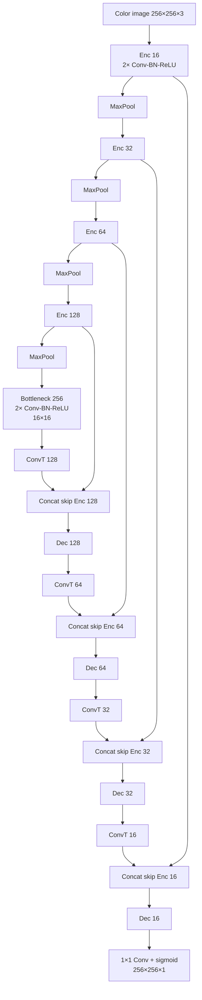

# U-Net Architecture

Baseline 2D U-Net used for binary ultrasound organ segmentation. The network takes a **color image of size 256 × 256 × 3** and predicts a single-channel mask. The graph below is taken from the Keras `model_config` stored in the `.h5` files under `models/unet/` (Keras **2.13.1**, TensorFlow backend). All six organ checkpoints share this architecture and differ only in trained weights.

| Checkpoint | Task |
| --- | --- |
| `bladder.h5` | Bladder |
| `kidney.h5` | Kidney |
| `liver.h5` | Liver |
| `diaphragm.h5` | Diaphragm |
| `spleen.h5` | Spleen |
| `spine.h5` | Spine |

## Overview

This is a **lightweight U-Net** (starting width 16, not the original 64). Each organ is a **separate binary model**: one **color image** in, one probability map out. There is no dropout. Encoder blocks are `Conv → BN → ReLU` twice, then `MaxPool`. The decoder upsamples with `Conv2DTranspose`, concatenates the matching encoder skip, then repeats the same double convolution.

| Item | Value |
| --- | --- |
| Framework | Keras Functional API (`name="model"`) |
| Input | **Color image** `input_img`, shape **`(256, 256, 3)`**, `float32` (height × width × RGB channels) |
| Output | `conv2d_18`, shape `(256, 256, 1)`, sigmoid |
| Depth | 4 downsampling stages + bottleneck at `16×16` |
| Channel widths | `16 → 32 → 64 → 128 → 256` (then symmetric) |
| Convolution | `3×3`, padding `same`, bias on, **HeNormal** |
| Normalization | BatchNorm, `axis=channels`, momentum `0.99`, ε `0.001` |
| Downsample | `MaxPooling2D` `2×2`, stride `2` |
| Upsample | `Conv2DTranspose` `2×2`, stride `2`, padding `same`, **GlorotUniform** |
| Skip connections | Channel-wise `Concatenate` with encoder activations |
| Head | `1×1` convolution, sigmoid, **GlorotUniform** |
| Parameters | **~1.94 M** trainable (~1.95 M including BN moving stats) |
| Loss | `imageseg:::bce_dice_loss` |
| Metrics | `imageseg:::dice_coef`, `imageseg:::jaccard_index` |
| Optimizer (compiled) | Adam, `lr=1e-3`, `β1=0.9`, `β2=0.999`, `amsgrad=false` |

## Block diagram

## Stage map

Each **Enc/Dec** cell is two `3×3` convolutions, each followed by BatchNorm and ReLU. Spatial size is shown after the block (after pooling on the encoder, after transpose+convs on the decoder).

| Stage | Operation | Spatial | Channels | Skip |
| --- | --- | ---: | ---: | --- |
| Input | Color image (RGB) | 256 | 3 | — |
| Encoder 1 | 2 × Conv-BN-ReLU | 256 | 16 | → decoder 1 |
| Pool 1 | MaxPool 2×2 | 128 | 16 | |
| Encoder 2 | 2 × Conv-BN-ReLU | 128 | 32 | → decoder 2 |
| Pool 2 | MaxPool 2×2 | 64 | 32 | |
| Encoder 3 | 2 × Conv-BN-ReLU | 64 | 64 | → decoder 3 |
| Pool 3 | MaxPool 2×2 | 32 | 64 | |
| Encoder 4 | 2 × Conv-BN-ReLU | 32 | 128 | → decoder 4 |
| Pool 4 | MaxPool 2×2 | 16 | 128 | |
| Bottleneck | 2 × Conv-BN-ReLU | 16 | 256 | — |
| Up 4 | ConvT 2×2 / concat / 2 × Conv-BN-ReLU | 32 | 128 | encoder 4 |
| Up 3 | ConvT 2×2 / concat / 2 × Conv-BN-ReLU | 64 | 64 | encoder 3 |
| Up 2 | ConvT 2×2 / concat / 2 × Conv-BN-ReLU | 128 | 32 | encoder 2 |
| Up 1 | ConvT 2×2 / concat / 2 × Conv-BN-ReLU | 256 | 16 | encoder 1 |
| Head | 1×1 Conv, sigmoid | 256 | 1 | — |

## Convolutional block

Used at every encoder, bottleneck, and decoder stage:

1. `Conv2D(filters, 3×3, padding=same, activation=linear, HeNormal)`
2. `BatchNormalization`
3. `ReLU`
4. Repeat 1–3 with the same `filters`

Decoder stages insert `Conv2DTranspose` and `Concatenate` **before** this block. Skip tensors are the ReLU output of the matching encoder stage .

## Loss and metrics

- `bce_dice_loss`: binary cross-entropy plus soft Dice loss, `BCE(y, ŷ) + (1 − dice_coef(y, ŷ))`.
- `dice_coef`: soft Dice coefficient on flattened `y_true` / `y_pred` (smooth `1.0`).
- `jaccard_index`: IoU after thresholding both tensors at `0.5`.

## Differences from the original U-Net

Relative to Ronneberger et al. (2015):

- Starts at **16** filters instead of 64 (about 1/16 the width).
- Uses **BatchNorm + ReLU** after each convolution instead of unnormalized ReLU.
- Upsamples with **learned `Conv2DTranspose`**, not bilinear/`UpSampling2D` plus a convolution.
- Valid-padding crops are unnecessary because all encoder/decoder convolutions use **`same` padding**.
- Final activation is **sigmoid** for one-vs-rest organ masks, not softmax over multiple classes.
- No dropout in the bottleneck.

## Inference notes

- Feed a **color image** as a `float32` tensor of shape **`(256, 256, 3)`** (RGB, last-channel format). Grayscale `(256, 256, 1)` is not compatible with these weights. 
- Threshold the sigmoid map (commonly `0.5`) to obtain a binary mask.
- Run **one checkpoint per organ**. The six heads are not a single multi-class network.
- Checkpoints are full Keras saves (graph + weights + Adam optimizer state)